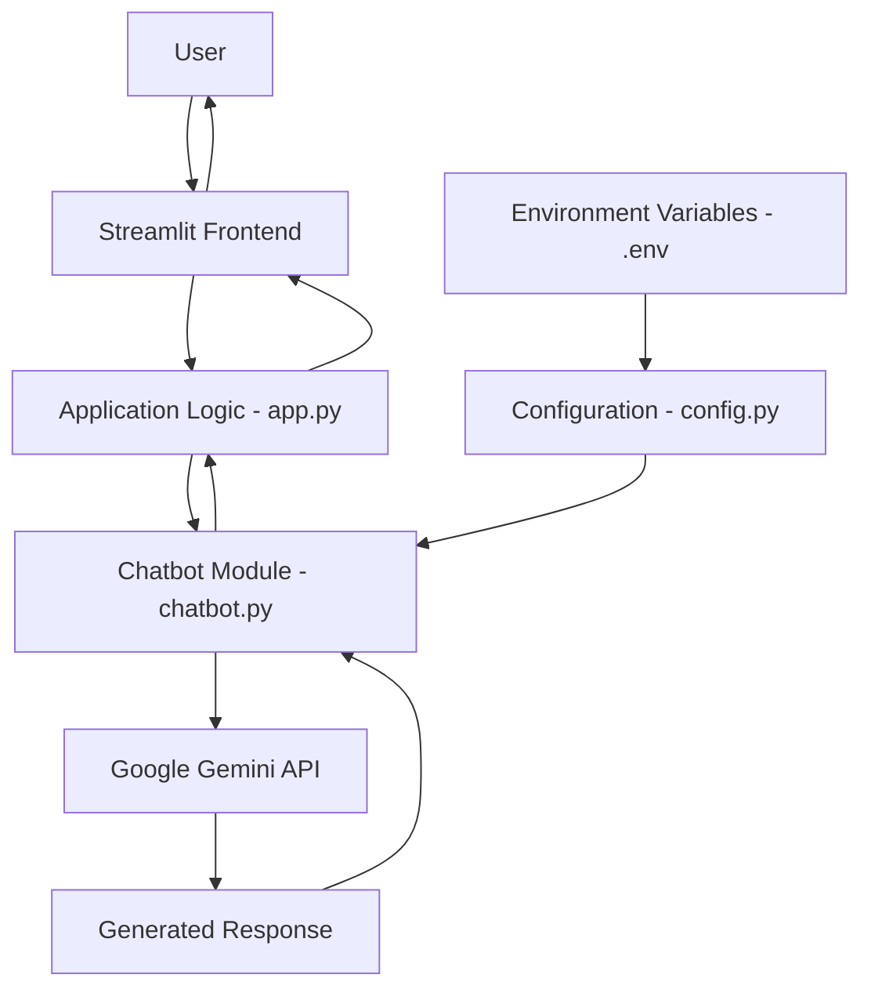
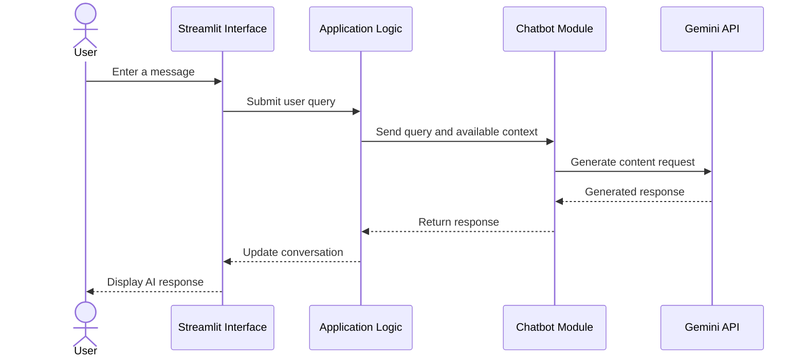

# 🧭 TripMate AI

### Ask Anything. Explore Everything.

> An AI-powered conversational assistant that combines general-purpose intelligence with context-aware travel planning, powered by Google Gemini and built using Python and Streamlit.
> 
---

## 📌 1. Project Overview

**TripMate AI** is a conversational AI application designed to make artificial intelligence accessible through a unified, interactive interface.

Unlike traditional chatbots restricted to predefined commands or specific domains, TripMate AI allows users to interact naturally with an AI assistant capable of handling a wide range of tasks, from explaining complex academic concepts and debugging code to generating personalized travel itineraries and budget-conscious trip plans.

Built using **Python, Streamlit, and Google's Gemini API**, the application combines the capabilities of a Large Language Model (LLM) with a conversational interface that supports multi-turn interactions and contextual follow-up questions.

The primary objective is to create an assistant that can understand user intent, generate relevant responses, maintain conversational continuity, and adapt its recommendations as user requirements evolve.

### 🎯 Core Objectives

- Develop a general-purpose conversational AI assistant.
- Integrate Google's Gemini API for natural language understanding and generation.
- Enable context-aware, multi-turn conversations.
- Generate structured travel itineraries based on user requirements.
- Support dynamic modifications to travel plans and budgets.
- Build an interactive interface with session management and response streaming.
- Handle API configuration and common integration errors gracefully.

---

## 🚨 2. Problem Statement

Modern users frequently switch between multiple applications and platforms to accomplish tasks involving information retrieval, problem-solving, learning, programming assistance, and travel planning.

For example:

- A student might need an AI assistant to understand a difficult academic concept.
- A developer might need help identifying and correcting a programming error.
- A traveller might want a day-wise itinerary within a fixed budget.
- Someone planning a vacation might need to compare destinations based on cost, activities, and travel preferences.
- A user might want to modify an earlier recommendation without explaining the entire context again.

Traditional rule-based chatbots struggle with these scenarios because they generally depend on predefined responses, fixed workflows, and limited conversational flexibility.

Furthermore, many AI applications focus on a single domain, limiting their usefulness when users need assistance across different categories of tasks.

### The Challenge

The central engineering challenge is to create a unified conversational application that:

1. Accepts natural-language queries instead of requiring rigid commands.
2. Leverages an LLM to handle diverse categories of requests.
3. Preserves relevant conversation context across follow-up questions.
4. Produces structured and readable responses.
5. Provides a dedicated experience for travel-related planning.
6. Maintains a usable interface while handling external API communication.

---

## 💡 3. Proposed Solution

TripMate AI addresses these challenges through a conversational interface powered by Google's Gemini API.

Instead of implementing separate rule-based systems for every possible question, the application uses a general-purpose Large Language Model to interpret user input and generate contextually relevant responses.

The application is designed around two complementary capabilities:

| Capability                    | Purpose                                                                                                 |
| ----------------------------- | ------------------------------------------------------------------------------------------------------- |
| General-purpose AI assistance | Answer questions, explain concepts, assist with coding, solve problems, and generate content.           |
| AI-powered travel planning    | Generate itineraries, estimate budgets, compare destinations, and adapt plans to changing requirements. |

The user interacts with the application through a Streamlit interface. Messages are processed by the application's backend, which communicates with Gemini and returns the generated response to the interface.

The result is a single conversational environment that supports both everyday AI assistance and travel-oriented planning.

---

## 🧠 4. AI Architecture & Core Concepts

TripMate AI is built around Generative AI rather than a custom-trained machine learning model.

The intelligence behind the application comes from Google's Gemini Large Language Model, while the application layer manages user interaction, API communication, conversational context, and response presentation.

### 4.1 Large Language Models (LLMs)

A Large Language Model is an AI model trained on extensive text data to understand and generate human-like language.

Gemini acts as the primary reasoning and response-generation engine in TripMate AI.

It enables the application to:

- Interpret natural-language instructions.
- Understand questions across multiple domains.
- Generate explanations and structured responses.
- Assist with programming and debugging.
- Produce travel recommendations and itineraries.
- Respond to follow-up questions using available conversation context.

**Why an LLM instead of a traditional rule-based chatbot?**

A rule-based chatbot requires developers to define possible inputs, conditions, and corresponding responses.

An LLM provides significantly greater flexibility because it can interpret variations in natural-language input without requiring a separate predefined response for every query.

### 4.2 Prompt Engineering

Prompt engineering involves designing instructions and contextual input to guide an LLM toward generating useful and relevant responses.

In TripMate AI, the user query is sent to Gemini through the application's backend.

The quality and relevance of the generated output depend on the instructions, context, and information supplied to the model.

For travel planning, useful prompt information can include:

- Destination
- Number of travel days
- Total budget
- Preferred activities
- Accommodation preferences
- Transportation requirements
- User-specific constraints

**Example:**

```text
Plan a 5-day trip to Manali within ₹15,000.

Include:
1. Day-wise itinerary
2. Accommodation estimates
3. Transportation costs
4. Food expenses
5. Activities and sightseeing
6. Total estimated budget
```

The model uses the supplied requirements to generate a structured travel recommendation.

### 4.3 Conversational Context Management

A major limitation of basic chatbot implementations is that they may treat every user message as an independent request.

This creates problems when users ask follow-up questions.

For example:

```text
User:
Plan a 5-day trip to Manali under ₹15,000.

AI:
Generates a travel itinerary.

User:
Can you reduce the budget to ₹10,000?

AI:
Needs the earlier travel context to understand
which itinerary should be modified.
```

Conversational context allows the application to provide relevant previous messages when processing subsequent requests.

This enables more natural multi-turn interactions.

### 4.4 Streaming Response Generation

Generating a complete response before displaying anything can make an AI application feel slow.

Streaming improves the perceived responsiveness of an application by displaying generated content progressively rather than waiting for the entire response.

TripMate AI is designed to provide a real-time conversational experience through response streaming.

### 4.5 Travel Constraint Interpretation

Travel planning is not simply about recommending destinations. It involves interpreting multiple constraints simultaneously.

For example:

- Budget restrictions
- Number of days
- Accommodation costs
- Transportation expenses
- Food requirements
- Activities and sightseeing preferences

Gemini can use these requirements to generate a plan that attempts to satisfy the user's constraints.

When a user changes one requirement, such as reducing the budget, the application can use the conversational context to request an updated recommendation.

**Important:** These recommendations are AI-generated estimates. They are not verified live prices, confirmed bookings, or guaranteed travel costs.

---

## ⚙️ 5. Algorithms & Engineering Techniques

TripMate AI primarily uses a pre-trained Generative AI model. It does not claim to train a custom neural network or implement a proprietary machine learning algorithm.

Its engineering logic lies in integrating an external LLM into a conversational application.

The following concepts describe the major techniques involved in this type of system.

### 5.1 Conversational Message Processing

A conversational application needs to organize messages so that the model can understand the interaction.

A simplified representation of a conversation is:

```python
conversation = [
    {
        "role": "user",
        "content": "Plan a trip to Manali."
    },
    {
        "role": "assistant",
        "content": "Here is your itinerary..."
    },
    {
        "role": "user",
        "content": "Reduce the budget."
    }
]
```

The application can use the available conversation history while constructing subsequent model requests.

This provides the foundation for contextual follow-up interactions.

### 5.2 LLM Request-Response Pipeline

The application follows a request-response architecture.

**Conceptual workflow:**

```text
User Query
    |
    v
Streamlit Interface
    |
    v
Application Backend
    |
    v
Conversation Context
    |
    v
Gemini API Request
    |
    v
LLM Response Generation
    |
    v
Response Processing
    |
    v
Streamlit Chat Interface
    |
    v
User
```

### 5.3 Session Management

A conversational interface needs to maintain separate interactions rather than mixing every conversation into a single chat.

TripMate AI includes multi-session chat functionality.

The intended session-management workflow is:

1. Create a new conversation.
2. Accept user messages.
3. Associate messages with the active conversation.
4. Preserve conversation history for later follow-ups.
5. Allow users to switch between previous conversations.
6. Provide options to clear or export a conversation.

### 5.4 Error Handling

Communication with external AI services can fail for several reasons.

Examples include:

- Missing API credentials.
- Invalid API keys.
- API rate limits.
- Network connectivity problems.
- Service-side failures.

A robust application should detect these conditions and provide meaningful feedback rather than exposing confusing technical errors to the user.

TripMate AI includes API configuration and error-handling considerations to make the application easier to operate.

---

## 🏗️ 6. System Architecture

The application follows a modular architecture that separates the user interface, AI communication, and configuration responsibilities.

### High-Level Architecture



### Architectural Components

| Component             | Responsibility                                       |
| --------------------- | ---------------------------------------------------- |
| Streamlit Frontend    | Provides the interactive chat interface.             |
| Application Logic     | Handles user interactions and application workflow.  |
| Chatbot Module        | Manages communication with the Gemini API.           |
| Configuration Module  | Handles model and API configuration.                 |
| Environment Variables | Store sensitive API credentials outside source code. |
| Gemini API            | Generates natural-language responses.                |

### Design Approach

The project uses a modular structure to separate different responsibilities.

This makes the application easier to understand, maintain, debug, and extend.

For example, changes to API configuration can be handled separately from the visual interface, while chatbot-related functionality can be maintained independently of the UI.

---

## 🔄 7. End-to-End Data Flow

The following sequence illustrates the conceptual journey of a user query through the application.



### Step-by-Step Execution

**Step 1: User Input**

The user enters a question or instruction through the Streamlit chat interface.

**Step 2: Input Processing**

The application receives the message and processes it through the relevant application logic.

**Step 3: Context Preparation**

Available conversation history is used to provide relevant context for follow-up questions.

**Step 4: API Communication**

The chatbot module communicates with Google's Gemini API using the configured model and API credentials.

**Step 5: Response Generation**

Gemini processes the request and generates a natural-language response.

**Step 6: Response Presentation**

The application displays the generated response through the chat interface.

**Step 7: Conversation Continuity**

The conversation can continue with additional user messages and follow-up instructions.

---

## ✈️ 8. Travel Planning Engine

One of the defining aspects of TripMate AI is its travel-planning functionality.

Instead of providing only static destination information, the application allows users to describe their travel requirements in natural language.

### 8.1 Day-Wise Itinerary Generation

Users can request structured itineraries divided into:

- Morning
- Afternoon
- Evening

This makes recommendations easier to understand and follow.

### 8.2 Budget Estimation

The application can generate approximate budget breakdowns across major travel expenses.

| Expense Category | Example                     |
| ---------------- | --------------------------- |
| Accommodation    | Hotel or hostel estimates   |
| Transportation   | Local and intercity travel  |
| Food             | Daily food expenses         |
| Activities       | Sightseeing and experiences |
| Miscellaneous    | Additional expenses         |

The total estimated budget can be presented in the relevant currency, such as INR, USD, or EUR.

### 8.3 Destination Comparison

Users can compare two destinations based on factors such as:

- Estimated expenses
- Sightseeing opportunities
- Activities
- Travel experience
- Suitability for their preferences

**Example:**

```text
Compare Goa and Kerala for a 5-day vacation
with a budget of ₹20,000.

Which destination offers better value?
```

### 8.4 Dynamic Plan Modification

A useful travel assistant should support changing requirements.

For example:

```text
Initial Request:
Plan a 5-day trip to Manali under ₹15,000.

Follow-up:
Reduce the budget to ₹10,000.

Further Follow-up:
Include more adventure activities.
```

The conversational interface allows users to refine their plans through follow-up instructions instead of starting from scratch.

---

## 🖥️ 9. User Interface & Application Features

TripMate AI focuses on providing a familiar conversational experience.

### Core Interface Features

- ChatGPT-inspired chat layout.
- Dark navy visual theme.
- User and assistant message separation.
- Markdown-formatted AI responses.
- Support for code blocks, tables, lists, and mathematical content.
- Chat session management.
- Conversation history navigation.
- New conversation functionality.
- Conversation export in Markdown format.
- API key configuration and connection testing.

### UI Theme

| Element    | Color     |
| ---------- | --------- |
| Background | `#0B1120` |
| Accent     | `#38BDF8` |
| Theme      | Dark Navy |

The interface uses a minimal visual approach to keep attention focused on the conversation.

---

## 🛠️ 10. Technology Stack

The project combines a lightweight Python application framework with a cloud-based Generative AI service.

| Technology        | Purpose                    | Why It Is Used                                         |
| ----------------- | -------------------------- | ------------------------------------------------------ |
| Python            | Core programming language  | Backend logic and application development              |
| Streamlit         | Frontend framework         | Rapid development of interactive web applications      |
| Google Gemini API | AI engine                  | Natural-language understanding and response generation |
| `google-genai`    | Official Google Gen AI SDK | Communication with Gemini models                       |
| python-dotenv     | Configuration management   | Loading environment variables                          |
| Markdown          | Response formatting        | Readable presentation of generated content             |
| Git & GitHub      | Version control            | Source-code management and collaboration               |

### Why Streamlit?

Streamlit allows developers to build interactive web applications directly using Python.

It reduces the need to maintain separate frontend and backend implementations for a project of this scope.

### Why Google Gemini?

Gemini provides general-purpose language generation capabilities that support the diverse requirements of TripMate AI.

Integrating an existing LLM also allows the project to focus on application engineering, conversational workflows, and user experience rather than training a foundation model from scratch.

---

## 📂 11. Project Structure

```text
TripMate-AI/
│
├── .streamlit/
│   └── config.toml
│
├── app.py
│   └── Main Streamlit application
│
├── chatbot.py
│   └── Gemini API integration and chatbot logic
│
├── config.py
│   └── API configuration and environment handling
│
├── .env.example
│   └── Example environment configuration
│
├── .gitignore
│   └── Files excluded from version control
│
├── requirements.txt
│   └── Project dependencies
│
└── README.md
    └── Project documentation
```

### Module Responsibilities

**`app.py` — Application Layer**

Responsible for the Streamlit interface, user interactions, and the overall application workflow.

**`chatbot.py` — AI Integration Layer**

Responsible for the chatbot's interaction with the Gemini API and response-generation workflow.

**`config.py` — Configuration Layer**

Responsible for application configuration and retrieving the required API credentials.

**`.streamlit/config.toml` — Streamlit Configuration**

Contains configuration options for the Streamlit application.

**`.env.example` — Environment Template**

Provides an example of the environment variables required to run the application.

**`requirements.txt` — Dependency Management**

Lists the Python packages needed to install and run the application.

---

## 🔐 12. API Configuration & Security

TripMate AI uses Google's Gemini API to generate AI responses.

API credentials should never be hardcoded directly into source files or committed to a public repository.

The application uses environment-based configuration.

### Environment Variable

```env
GEMINI_API_KEY=your_google_gemini_api_key
```

### Configuration Workflow

```text
.env File
    |
    v
python-dotenv
    |
    v
Environment Variable
    |
    v
Configuration Module
    |
    v
Gemini API Client
```

### Security Practices

- Keep `.env` excluded from Git version control.
- Never publish a real API key in source code.
- Use `.env.example` to document required environment variables.
- Regenerate exposed API credentials immediately.
- Avoid sharing sensitive API configuration in screenshots or public documentation.

Get your API key from [Google AI Studio](https://aistudio.google.com/).

---

## ⚠️ 13. Limitations & Considerations

Although TripMate AI provides a flexible conversational experience, it has certain limitations.

**1. AI-Generated Information**

Responses are generated by an LLM and may occasionally contain inaccurate or incomplete information.

**2. Travel Budget Accuracy**

Travel budgets are approximate estimates and may differ from actual expenses due to seasonal pricing, location, availability, and personal preferences.

**3. No Guaranteed Live Availability**

The application should not be treated as a real-time hotel, flight, or activity booking platform.

**4. External API Dependency**

AI response generation depends on the availability and accessibility of the Gemini API.

**5. Context Limitations**

The amount of conversation history that can be processed depends on the model's context capacity and the application's context-management approach.

**6. API Usage Limits**

API availability and request limits depend on the selected Google AI plan and its applicable quotas.

---

## 🚀 14. Future Scope

TripMate AI can be extended into a more comprehensive AI-powered personal assistant.

Potential improvements include:

- **Live Travel Data Integration:** Connect real-time weather, flight, hotel, and transportation APIs.
- **Map Integration:** Display destinations, routes, and sightseeing locations through interactive maps.
- **Persistent Chat Storage:** Introduce a database to store conversations across application restarts.
- **Personalized Recommendations:** Use saved preferences to improve travel suggestions.
- **Multilingual Support:** Support conversations in multiple languages.
- **Voice Interaction:** Add speech-to-text and text-to-speech capabilities.
- **Advanced Travel Optimization:** Introduce constraint-based planning to optimize itineraries based on budget, travel time, and user preferences.
- **Authentication:** Add user accounts and private conversation histories.
- **Deployment:** Host the application on a cloud platform for public access.

---

## 💻 15. Installation & Setup

Follow these steps to run TripMate AI locally.

### Prerequisites

- Python 3.10 or above
- pip package manager
- Google Gemini API key
- Git

### Step 1: Clone the Repository

```bash
git clone https://github.com/YOUR-USERNAME/TripMate-AI.git
```

```bash
cd TripMate-AI
```

### Step 2: Create a Virtual Environment

```bash
python -m venv venv
```

Activate it on Windows:

```bash
venv\Scripts\activate
```

Activate it on macOS/Linux:

```bash
source venv/bin/activate
```

### Step 3: Install Dependencies

```bash
pip install -r requirements.txt
```

### Step 4: Configure API Credentials

Create a `.env` file in the project root directory.

Add:

```env
GEMINI_API_KEY=your_google_gemini_api_key
```

Replace the placeholder with your actual Gemini API key.

### Step 5: Run the Application

```bash
streamlit run app.py
```

The application will open in your default browser.

---

## 💬 16. Example Prompts

Try the following prompts to explore TripMate AI.

### General AI Assistance

```text
Explain quantum computing in simple language
with practical examples.
```

```text
Explain Python asyncio and demonstrate
how asynchronous programming works.
```

```text
Help me debug this Python code.
```

### Travel Planning

```text
Plan a 5-day trip to Manali
under a budget of ₹15,000.
```

```text
Compare Goa and Kerala for a 5-day vacation.
```

```text
Create a 3-day itinerary for Jaipur
with historical places and local food.
```

### Contextual Follow-Ups

```text
Can you reduce the budget to ₹10,000?
```

```text
Include more adventure activities.
```

```text
Make the itinerary more relaxed.
```

---

## 🎓 17. Key Learning Outcomes

Building TripMate AI provided practical exposure to several important areas of software development and Generative AI.

- **Generative AI Integration:** Working with Google's Gemini API through its official Python SDK.
- **Prompt Engineering:** Understanding how instructions and context influence LLM-generated responses.
- **Conversational AI:** Designing multi-turn chatbot interactions.
- **Python Application Development:** Organizing application logic into separate modules.
- **Streamlit Development:** Building interactive web interfaces using Python.
- **API Integration:** Managing communication between a local application and an external AI service.
- **Configuration Management:** Handling API credentials through environment variables.
- **Error Handling:** Considering failures involving external API services.
- **Project Documentation:** Structuring a software project for maintainability and developer accessibility.

---

## 👨‍💻 18. Author

**Developed as a hands-on Generative AI and Python application development project.**

If you found this project interesting, consider giving the repository a ⭐ on GitHub.

---

## ⭐ Final Note

TripMate AI explores how Large Language Models can be integrated into practical applications to create more natural, flexible, and context-aware user experiences.

The project demonstrates the combination of Generative AI, API integration, Python development, and interactive application design in a single working application.

**TripMate AI — Ask Anything. Explore Everything.**

