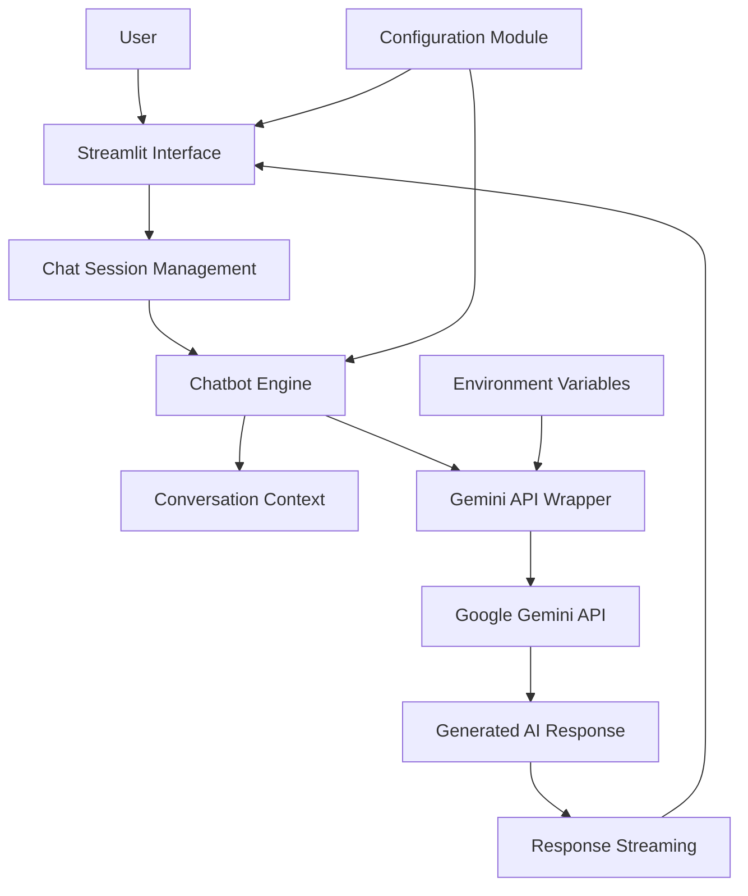

# 🧭 TripMate AI

### Ask Anything. Explore Everything.

> A conversational AI assistant powered by Google's Gemini API, combining general-purpose intelligence with specialized travel planning capabilities.

---

## 📌 Table of Contents

- [Overview](#-overview)
- [The Problem](#-the-problem)
- [Key Features](#-key-features)
- [Technology Stack](#-technology-stack)
- [System Architecture](#-system-architecture)
- [Project Structure](#-project-structure)
- [How It Works](#-how-it-works)
- [Getting Started](#-getting-started)
- [Environment Configuration](#-environment-configuration)
- [Example Use Cases](#-example-use-cases)
- [Error Handling](#-error-handling)
- [Future Enhancements](#-future-enhancements)

---

## 🌟 Overview

**TripMate AI** is a modern, general-purpose conversational AI application built using Python, Streamlit, and Google's official Gemini API through the `google-genai` SDK.

Inspired by the conversational experience of ChatGPT, TripMate AI allows users to interact with an AI assistant that can explain complex concepts, generate and debug code, solve problems, assist with learning, and maintain context across multiple conversation turns.

Beyond general-purpose assistance, TripMate AI introduces specialized travel intelligence capabilities that help users plan trips, estimate expenses, compare destinations, and dynamically modify travel itineraries according to changing preferences and budgets.

The application combines an intuitive conversational interface, real-time response streaming, multi-session chat management, and secure API configuration into a unified experience.

**The idea:** One AI assistant for everyday problem-solving and smarter travel planning.

---

## 🎯 The Problem

People frequently switch between multiple applications and platforms for everyday assistance and travel planning.

- General AI tools are used for learning, coding, research, and problem-solving.
- Travel websites are used to compare destinations, estimate expenses, and organize itineraries.
- Changing a travel budget or modifying an existing itinerary often requires manually revisiting multiple details.

TripMate AI aims to simplify this experience by bringing general-purpose AI assistance and travel planning into one conversational interface.

### 💡 The Solution

Instead of treating every request as an isolated query, TripMate AI maintains conversational context, allowing users to ask follow-up questions, refine previous responses, and modify travel plans naturally.

For example:

1. Ask for a 5-day Manali itinerary under ₹15,000.
2. Request a breakdown of accommodation, transportation, food, and activities.
3. Reduce the budget to ₹10,000.
4. Ask the assistant to modify the itinerary while respecting the new constraint.

All through a single conversation.

---

## ✨ Key Features

### 🌐 1. General-Purpose AI Assistant

TripMate AI is not restricted to travel-related queries. It works as an everyday AI assistant capable of handling diverse tasks.

- **Academic Assistance:** Explains technical and academic concepts in simple language.
- **Programming Support:** Generates, explains, and debugs Python code.
- **Problem Solving:** Helps with mathematics, science, logic, and analytical questions.
- **Technical Guidance:** Assists with software architecture and programming concepts.
- **Creative Assistance:** Supports content generation, writing, and brainstorming.
- **Contextual Conversations:** Uses conversation history to support meaningful follow-up questions.

### ✈️ 2. Intelligent Travel Planning

A specialized travel planning experience designed to simplify trip organization.

- **Day-by-Day Itineraries:** Generates structured Morning, Afternoon, and Evening travel plans.
- **Budget Estimation:** Breaks down estimated expenses across accommodation, transportation, food, and activities.
- **Destination Comparison:** Compares destinations based on budget, attractions, experiences, and preferences.
- **Dynamic Replanning:** Modifies existing itineraries when users change their budget or travel preferences.
- **Flexible Planning:** Adapts recommendations according to the user's conversational requirements.

*Note: Travel budgets and expense estimates are AI-generated suggestions, not verified live prices or bookings.*

### 🎨 3. Modern ChatGPT-Inspired Interface

Designed to provide a clean and intuitive conversational experience.

- Premium dark navy interface with blue and cyan accents.
- Modern chat bubbles with user and assistant avatars.
- Markdown rendering for structured responses.
- Syntax-highlighted code blocks.
- Support for tables, lists, and LaTeX mathematical expressions.
- Real-time streaming of generated responses.

### 💬 4. Multi-Session Conversation Management

Designed to make conversations easier to organize and revisit.

- Start new conversations using the New Chat functionality.
- Switch between previously created chat sessions.
- Automatically generate conversation titles based on the initial query.
- Clear the current conversation.
- Export conversations in Markdown format.
- Maintain separate conversation histories across sessions.

### 🔐 5. Secure Gemini API Integration

Built using Google's official Python SDK.

- Integration through `google-genai`.
- Environment-based API key configuration.
- Support for `.env` and `.env.example`.
- In-app API key configuration.
- API connection testing.
- Graceful handling of invalid API keys, rate limits, missing credentials, and network errors.

---

## 🛠️ Technology Stack

| Technology        | Purpose                                       |
| ----------------- | --------------------------------------------- |
| Python            | Core application logic                        |
| Streamlit         | Frontend and interactive web interface        |
| Google Gemini API | Generative AI and conversational intelligence |
| google-genai      | Official Google GenAI Python SDK              |
| python-dotenv     | Environment variable and API key management   |
| Markdown          | Structured AI response rendering              |
| CSS               | UI customization and visual styling           |

---

## 🏗️ System Architecture

TripMate AI follows a modular architecture that separates the user interface, AI communication logic, and application configuration.



### Architecture Components

| Component    | Responsibility                                                                           |
| ------------ | ---------------------------------------------------------------------------------------- |
| `app.py`     | Manages the Streamlit interface, user interactions, chat sessions, and response display. |
| `chatbot.py` | Handles Gemini API communication, response generation, streaming, and error handling.    |
| `config.py`  | Centralizes system prompts, suggested prompts, and custom UI styling.                    |
| `.env`       | Stores local environment configuration and API credentials.                              |

This modular organization improves code readability, maintainability, and separation of responsibilities.

---

## 📁 Project Structure

```text
TripMate-AI/
│
├── .streamlit/
│   └── config.toml          # Streamlit theme configuration
│
├── app.py                   # Main application and chat interface
│
├── chatbot.py               # Gemini API integration and chat engine
│
├── config.py                # System prompts, suggestions, and CSS
│
├── requirements.txt         # Python dependencies
│
├── .env                     # Local API credentials (not committed)
│
├── .env.example             # Environment configuration template
│
├── .gitignore               # Files excluded from version control
│
└── README.md                # Project documentation
```

---

## ⚙️ How It Works

The application follows a conversational request-response workflow.

**Step 1: User Input**

The user enters a question or request through the Streamlit chat interface.

**Step 2: Context Management**

The application retrieves the relevant conversation history to support contextual follow-up questions.

**Step 3: AI Request Processing**

The chatbot engine prepares the request and communicates with Google's Gemini API using the official `google-genai` SDK.

**Step 4: Response Generation**

Gemini processes the prompt and generates an AI response.

**Step 5: Streaming and Rendering**

The generated response is streamed back to the interface and displayed with Markdown formatting.

**Step 6: Conversation Continuity**

The conversation is maintained within its chat session, allowing the user to continue interacting without starting from scratch.

---

## 🚀 Getting Started

Follow these instructions to run TripMate AI locally.

### 1. Prerequisites

Make sure you have:

- Python 3.10 or later.
- pip package manager.
- Internet connectivity.
- A Google Gemini API key.

### 2. Clone the Repository

```bash
git clone https://github.com/YOUR_USERNAME/TripMate-AI.git
```

Navigate to the project directory:

```bash
cd TripMate-AI
```

### 3. Create a Virtual Environment (Recommended)

```bash
python -m venv venv
```

Activate it:

**Windows:**

```bash
venv\Scripts\activate
```

**macOS / Linux:**

```bash
source venv/bin/activate
```

### 4. Install Dependencies

```bash
pip install -r requirements.txt
```

### 5. Configure Gemini API Key

Get your API key from:

[Google AI Studio – Get API Key](https://aistudio.google.com/app/apikey)

Create a `.env` file in the project root directory.

Copy the following configuration:

```env
GEMINI_API_KEY=your_actual_gemini_api_key
```

Alternatively, configure your API key directly through the in-app Gemini API Configuration section, if enabled.

### 6. Run the Application

```bash
streamlit run app.py
```

Open the application in your browser:

```text
http://localhost:8501
```

You're ready to explore TripMate AI!

---

## 💡 Example Use Cases

### 📚 General Knowledge & Learning

```text
Explain quantum computing and superposition
in simple terms with an everyday analogy.
```

### 💻 Programming & Debugging

```text
Write a Python script using asyncio to
perform concurrent tasks with error handling.
```

### 🏔️ Travel Planning

```text
Plan a 5-day budget-friendly trip to Manali
under ₹15,000, including accommodation,
food, transportation, and daily activities.
```

### 💰 Dynamic Budget Adjustment

```text
Now reduce my budget to ₹10,000.
Modify the itinerary while keeping the
most important activities.
```

### 🌴 Destination Comparison

```text
Compare Goa and Kerala for a 4-day
December vacation based on budget,
beaches, food, and overall experience.
```

### 🧠 Technical Problem Solving

```text
Explain how a Random Forest classifier
works and why it is useful for
classification problems.
```

---

## 🛡️ Error Handling & Reliability

TripMate AI is designed to handle common API and application failures gracefully.

| Scenario            | Application Behaviour                    |
| ------------------- | ---------------------------------------- |
| Missing API key     | Displays configuration instructions      |
| Invalid API key     | Provides an authentication error message |
| API rate limit      | Handles rate-limit errors gracefully     |
| Network failure     | Reports connectivity issues              |
| API request failure | Displays an appropriate error message    |
| Empty user input    | Prevents unnecessary API requests        |

The application does not generate fabricated or simulated AI responses when Gemini API access is unavailable.

---

## 🔮 Future Enhancements

TripMate AI has several opportunities for further development.

- [ ] Integration with live weather information for travel planning.
- [ ] Real-time flight and hotel price comparisons.
- [ ] Interactive maps and destination exploration.
- [ ] Persistent conversation storage using a database.
- [ ] User authentication and personalized chat histories.
- [ ] Export travel itineraries as PDF documents.
- [ ] Multilingual conversational support.
- [ ] Voice-based interaction.
- [ ] Improved travel recommendations based on user preferences.

---

## 🔒 Security Considerations

- API credentials are stored in environment variables rather than hardcoded into application files.
- `.env` should be excluded from Git version control.
- `.env.example` provides a safe configuration template without exposing actual credentials.
- API keys should never be committed to a public repository.

---

## 👨‍💻 Author

**APOORVA SHREE**
